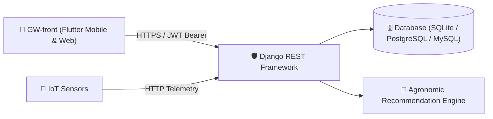

# 🌿 GrowWise Backend (`GW-back`)

[](https://www.python.org/)
[](https://www.djangoproject.com/)
[](https://www.django-rest-framework.org/)
[](https://django-rest-framework-simplejwt.readthedocs.io/)
[](https://www.docker.com/)
[](https://render.com)

The backend service powering the **GrowWise** smart agriculture and plant telemetry ecosystem. It provides robust RESTful APIs for real-time sensor telemetry ingestion (soil moisture, temperature, NPK nutrients), user authentication, device management, and intelligent agronomic crop recommendations.

---

## 📋 Table of Contents
- [Architecture & Tech Stack](#-architecture--tech-stack)
- [Key Features](#-key-features)
- [Repository Structure](#-repository-structure)
- [API Reference](#-api-reference)
- [Getting Started](#-getting-started)
  - [Prerequisites](#prerequisites)
  - [Local Installation](#local-installation)
  - [Environment Variables](#environment-variables)
  - [Database Migrations & Test User](#database-migrations--test-user)
- [Running with Docker](#-running-with-docker)
- [Deployment (Render)](#-deployment-render)
- [Contributing & License](#-contributing)

---

## 🏗 Architecture & Tech Stack



- **Backend Framework**: Django 4.2 LTS & Django REST Framework
- **Authentication**: JSON Web Tokens (`djangorestframework-simplejwt`)
- **Database**: SQLite (local development), PostgreSQL / MySQL (production via `dj-database-url`)
- **Static Assets**: WhiteNoise
- **Containerization & Deployment**: Docker, Docker Compose, Gunicorn, Render Blueprint (`render.yaml`)

---

## ✨ Key Features

- **JWT Authentication & Security**: Register, login, token refresh, profile retrieval, and logout endpoints.
- **Sensor Telemetry Management**: Full CRUD endpoints for IoT hardware measuring:
  - 🌡 **Temperature** (°C)
  - 💧 **Moisture / Humidity**
  - 🧪 **Macronutrients (NPK)**: Nitrogen (N), Phosphorus (P), Potassium (K)
  - 📍 **GPS / Location tagging**
- **Smart Agronomic Recommendation Engine**: Evaluates crop conditions (e.g. Tomatoes, Cucumbers, Carrots, Potatoes) against optimal agricultural thresholds and returns targeted soil treatment insights.
- **User Sensor Association**: Allows authenticated users to claim and manage individual sensor hardware.
- **Production-Ready**: Pre-configured for deployment with Gunicorn, WhiteNoise, and automated Docker / Render builds.

---

## 📁 Repository Structure

```text
GW-back/
├── api/                     # Main Django application
│   ├── migrations/          # Database migrations
│   ├── auth_serializers.py  # User registration & profile serializers
│   ├── auth_views.py        # Authentication & JWT endpoints
│   ├── models.py            # Sensor and user data models
│   ├── serializers.py       # REST serializers for sensors & telemetry
│   ├── urls.py              # Application route definitions
│   └── views.py             # Telemetry CRUD & recommendation logic
├── dcrm/                    # Project settings & configuration
│   ├── asgi.py              # ASGI configuration (Channels)
│   ├── settings.py          # Django settings (env-aware)
│   ├── urls.py              # Root URL routing
│   └── wsgi.py              # WSGI entry point for Gunicorn
├── .env.example             # Example environment variables
├── .gitignore               # Comprehensive Git ignore rules
├── build.sh                 # Cloud build script for staticfiles & migrations
├── create_test_user.py      # Seed script to create initial developer user
├── docker-compose.yml       # Local container orchestration
├── Dockerfile               # Production container image
├── manage.py                # Django CLI entry point
├── Pipfile                  # Pipenv dependency specification
├── render.yaml              # Render Cloud deployment blueprint
└── requirements.txt         # Pinned Python package dependencies
```

---

## 🔌 API Reference

### 1. Authentication Endpoints

| Method | Endpoint | Auth Required | Description |
| :--- | :--- | :---: | :--- |
| `POST` | `/auth/register/` | No | Register a new user (`username`, `password`, `email`) |
| `POST` | `/auth/login/` | No | Authenticate and obtain JWT `access` & `refresh` tokens |
| `POST` | `/auth/refresh/` | No | Refresh an expired access token |
| `GET` / `PUT` | `/auth/profile/` | **Yes (Bearer)** | Get or update currently authenticated user profile |
| `POST` | `/auth/logout/` | **Yes (Bearer)** | Invalidate current session / log out |

### 2. Sensor & Telemetry Endpoints

| Method | Endpoint | Auth Required | Description |
| :--- | :--- | :---: | :--- |
| `GET` | `/sensors/` | Optional | Retrieve a list of all sensors |
| `GET` | `/sensors/<id>/` | Optional | Retrieve single sensor details by 6-char ID |
| `POST` | `/sensors/create/` | Optional | Ingest new sensor reading (`name`, `plant`, `temperature`, `humidity`, `nitrogen`, etc.) |
| `PUT` | `/sensors/<id>/update/` | Optional | Update sensor telemetry parameters |
| `DELETE` | `/sensors/<id>/delete/` | Optional | Remove a sensor |
| `POST` | `/sensor/add_location/<id>/` | Optional | Assign GPS / string location to a sensor |
| `GET` | `/sensor/get_location/<id>/` | Optional | Fetch sensor location |
| `PUT` | `/api/update_sensors/` | Optional | Batch update multiple sensor names/plant configurations |

### 3. Analytics & User Operations

| Method | Endpoint | Auth Required | Description |
| :--- | :--- | :---: | :--- |
| `GET` | `/apiRest/recommendations/` | Optional | Run the agronomic recommendation engine across sensors |
| `GET` | `/api/user/me/` | **Yes (Bearer)** | Retrieve all sensors assigned to the authenticated user |
| `POST` | `/api/add_sensors_to_user/` | **Yes (Bearer)** | Associate an array of sensor IDs with the authenticated user |

---

## 🚀 Getting Started

### Prerequisites
- **Python**: 3.11+
- **Git**
- Optional: **Docker** and **Docker Compose**

### Local Installation

1. **Clone the repository**:
   ```bash
   git clone https://github.com/cucuradu/GW-back.git
   cd GW-back
   ```

2. **Create and activate a virtual environment**:
   ```bash
   # Windows (PowerShell)
   python -m venv .venv
   .\.venv\Scripts\Activate.ps1

   # macOS / Linux
   python3 -m venv .venv
   source .venv/bin/activate
   ```

3. **Install dependencies**:
   ```bash
   pip install -r requirements.txt
   ```

### Environment Variables
Copy `.env.example` to `.env` and adjust your variables:
```bash
cp .env.example .env
```
*(On Windows: `Copy-Item .env.example .env`)*

By default, the backend will use SQLite (`db.sqlite3`). To connect to a PostgreSQL or MySQL database, simply specify `DATABASE_URL` in `.env`.

### Database Migrations & Test User

Apply migrations:
```bash
python manage.py migrate
```

Seed a test user (`test` / `testpass`):
```bash
python create_test_user.py
```

Run the development server:
```bash
python manage.py runserver 0.0.0.0:8000
```
The API is now live at: `http://localhost:8000`

---

## 🐳 Running with Docker

You can spin up the application with Docker and Docker Compose with a single command:

```bash
docker compose up --build
```

The containerized service will automatically apply migrations, collect static files, and start serving on port `8000`.

---

## ☁️ Deployment (Render)

This repository includes a pre-configured `render.yaml` specification for zero-config deployments on [Render](https://render.com):

1. Connect your GitHub repository to Render.
2. Create a new **Blueprint Instance** pointing to `render.yaml`.
3. Render automatically executes `build.sh` (installs packages, gathers static files, and applies migrations) and starts Gunicorn.

---

## 👥 Contributing

1. Fork the Project
2. Create your Feature Branch (`git checkout -b feature/NewFeature`)
3. Commit your Changes (`git commit -m 'feat: Add NewFeature'`)
4. Push to the Branch (`git push origin feature/NewFeature`)
5. Open a Pull Request